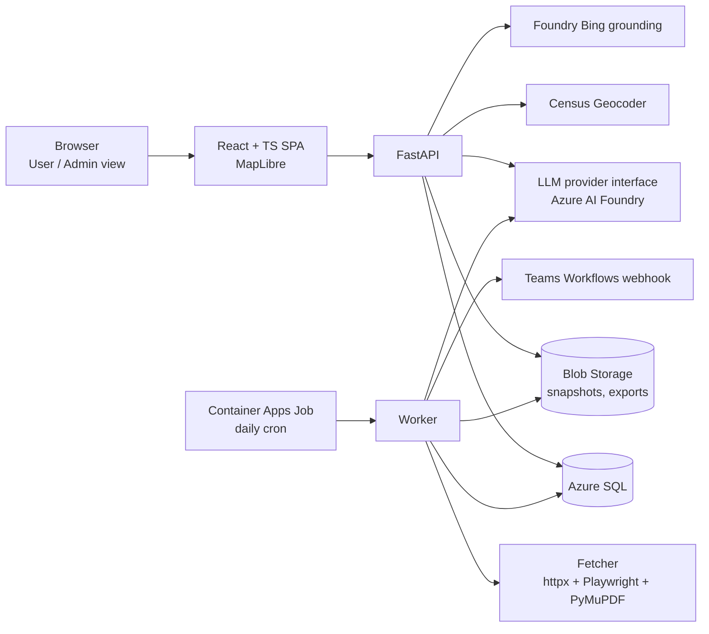

# JSE Local Regulations Portal — Project Plan

**Owner:** psethi (solo developer) · **Sponsor:** Jordan & Skala Engineers (JSE) · **Status:** Planning (MVP) · **Drafted:** 2026-11-01 · **Revised:** 2026-11-01 (sponsor answers applied)

An internal JSE portal that tracks the location-specific rules that affect MEP design: adopted code editions, local amendments, permitting and submittal requirements, utility rules, and newly passed ordinances. Engineers pick a place on a map (or type a project address) and get a sourced, current, exportable summary of what applies there.

---

## 0. Decisions log

| # | Decision | Consequence for the plan |
|---|---|---|
| D1 | Solo developer; this is an MVP | Scope is cut hard. Weekly milestones instead of team sprints. Prefer boring, managed services |
| D2 | Pilot metros: **Atlanta, Charlotte, Dallas, Houston, Denver, Tampa, Washington DC**, plus **Tuscaloosa** | About 30 jurisdictions to seed, so AI discovery and extraction do most of the seeding, with admin approval |
| D3 | Content scope: codes, amendments **and** permit/submittal requirements. MVP takes "whatever we can get"; a JSE engineer will define the final scope before production | The taxonomy (§1.5) is provisional and stored as data, not hard-coded, so it can change without a migration |
| D4 | **No auth system for the MVP.** There is a **User view** and an **Admin view** | User view: browse, export, submit URLs and manual entries. Admin view: approve, reject, edit, manage sources, run jobs. Admin is gated by one shared passcode (env var). See risk R9 |
| D5 | JSE has provided Azure and keys. **The model is swappable** | The LLM goes behind a provider interface. Model and deployment names come from config, never from code |
| D6 | Assume **no Municode or code-library subscription** | The fetcher must handle JS-rendered code sites (Playwright) and PDFs. Can be revisited later |
| D7 | **Microsoft Teams integration** for notifications | Daily digest and alerts posted to Teams channels through a Teams Workflows webhook (Adaptive Cards) |
| D8 | No existing JSE report template | We design one branded Word/PDF template from the brand guidelines |
| D9 | No integration with the MEP-QC tool yet | No public API. Keep the JSON export schema clean so integration is easy later |

---

## 1. Refined concept

### 1.1 The problem
Before a project starts, an engineer has to work out which code editions the jurisdiction has adopted, which local amendments change them, what the permit office wants in a submittal, and whether anything changed recently. Today that means digging through Municode, state agency pages, and county PDFs, and the knowledge stays with whoever did the digging last.

### 1.2 The product in one line
A map-first, source-cited register of MEP-relevant rules for each jurisdiction, kept current by a daily AI-assisted change monitor, with an admin approving changes before they count as verified.

### 1.3 Design principles

1. **Model rules by jurisdiction, not just by county.** Codes are layered, and the county is often not the authority having jurisdiction (AHJ):
   - **Model code** (IBC, IMC, IPC, IFGC, NEC, IECC/ASHRAE 90.1, NFPA 13/72) → **State adoption** → **County** (unincorporated areas) → **City** (inside city limits).
   - Pilot examples: Atlanta spans Fulton and DeKalb, and the City of Atlanta permits inside city limits. Texas counties have almost no building code authority, so Dallas and Houston rules come from the cities. Florida has one statewide building code with limited local amendments. Mecklenburg County runs one county-wide code enforcement office. Denver is a consolidated city-county. DC is a single jurisdiction with no state layer.
   - The **map shows counties**. Selecting one opens a **jurisdiction stack**: State → County → municipalities. An address resolves to the exact stack.
2. **Provenance is mandatory, and AI output is "Pending" until an admin approves it.** Every item stores the source URL, a snapshot of the page, a verbatim excerpt, and the date retrieved. Exports show verification status and a "verify with AHJ" disclaimer.
3. **Change detection is deterministic first, LLM second.** Fetch, normalize, hash, and diff; the LLM sees only diffs. This keeps cost low and the audit trail clean.
4. **Rules are structured records**, so JSON, Word, and PDF are three renderings of the same data.
5. **AI source discovery suggests; the admin decides.** Rejected URLs are remembered.

### 1.4 Views (no auth for the MVP)

| View | Who | Can do |
|---|---|---|
| **User** (default) | Any JSE staff with the link | Browse the map, search an address, view rules, export. **Submit** URLs and manual entries; these go into the admin queue and do not publish directly |
| **Admin** (`/admin`, passcode) | psethi, plus anyone given the passcode | Everything above, plus approve or reject sources, rules, and changes; edit rules; run "find sources" and "check now"; manage Teams channels; view job health and AI cost |

Submissions ask for an optional free-text **"Your name"** field (remembered in localStorage) so the audit log has some attribution without an auth system.

### 1.5 Taxonomy v0 (provisional, stored in DB tables)

- **Discipline:** Mechanical · Electrical · Plumbing · Fire Protection · Fuel Gas · Energy · General/Admin
- **Category:**
  - Adopted code and edition
  - Local amendment
  - Permit and submittal requirement
  - Plan review requirement
  - Inspection requirement
  - Licensing and seal requirement
  - Utility requirement
  - Environmental
  - Fees
  - Pending or proposed change
- **Status:** Pending · Verified · Superseded · Rejected

---

## 2. Feature list (re-prioritized for a solo MVP)

**P0** = MVP must-have · **P1** = MVP if time allows · **P2** = after MVP

### A. Map and navigation
| # | Feature | Pri |
|---|---|---|
| A1 | Interactive US map with state and county boundaries (zoom, pan, hover tooltip) | P0 |
| A2 | Coverage shading: none / partial / verified / changes pending | P0 |
| A3 | Click a county to open the side panel with its jurisdiction stack | P0 |
| A4 | Address search: resolves state, county, city or unincorporated; flies to the result | P0 |
| A5 | Jurisdiction name search | P0 |
| A6 | JSE office pins and a pilot-metro quick-jump bar | P1 |
| A7 | Municipal boundary overlay | P2 |
| A8 | Mobile layout | P2 |

### B. Jurisdiction detail
| # | Feature | Pri |
|---|---|---|
| B1 | Code adoption table per layer (state / county / city) | P0 |
| B2 | Rules list grouped by discipline and category, with filter and search | P0 |
| B3 | Rule card: summary, excerpt, source and snapshot links, layer, status, last verified | P0 |
| B4 | "Recent changes" timeline | P0 |
| B5 | Building department contacts and permit portal link | P1 |
| B6 | Compare two jurisdictions; Q&A over rules | P2 |

### C. Export
| # | Feature | Pri |
|---|---|---|
| C1 | JSON export (versioned schema) | P0 |
| C2 | Word export, JSE-branded, with citations and disclaimer | P0 |
| C3 | PDF export, generated from the same template | P0 |
| C4 | Options: verified-only vs. include pending, filter by discipline, merged stack for an address | P1 |

### D. Submissions and sources
| # | Feature | Pri |
|---|---|---|
| D1 | User submits a URL for a jurisdiction; it goes to the admin queue | P0 |
| D2 | User submits a manual rule; it goes to the admin queue | P0 |
| D3 | Admin approves a URL, which triggers fetch, snapshot, and AI extraction into pending rules | P0 |
| D4 | Source registry per jurisdiction (status, health, last fetched) | P0 |
| D5 | Duplicate detection and rejected-URL memory | P0 |
| D6 | PDF upload for extraction | P1 |
| D7 | Per-source scope selector | P1 |

### E. AI source discovery
| # | Feature | Pri |
|---|---|---|
| E1 | "Find sources" (admin) using Foundry with Bing grounding | P0 |
| E2 | Candidates show title, domain, relevance reason, and an official .gov badge | P0 |
| E3 | Approve or reject each candidate; approval triggers extraction | P0 |
| E4 | **Bulk seed:** run discovery for every pilot jurisdiction in one go | P0 |

### F. Daily monitoring
| # | Feature | Pri |
|---|---|---|
| F1 | Daily job: fetch approved sources, normalize, hash, diff | P0 |
| F2 | LLM triage of changed content (MEP relevant?), summary, and proposed rule actions | P0 |
| F3 | Change review in the admin queue, with a diff view | P0 |
| F4 | Broken or moved source detection | P0 |
| F5 | "Check now" button per source | P1 |

### G. Teams integration
| # | Feature | Pri |
|---|---|---|
| G1 | Post a daily digest to a Teams channel: new changes, pending queue size, broken sources (Adaptive Card with deep links) | P0 |
| G2 | Post an alert to Teams if the daily job fails | P0 |
| G3 | Route by metro (e.g., Atlanta changes go to the Atlanta office channel) through webhook-to-metro mapping set in the admin view | P1 |
| G4 | Post a message when a user submission arrives, so the admin sees it | P1 |
| G5 | Interactive approve/reject from Teams (requires a bot registration) | P2 |

### H. Platform
| # | Feature | Pri |
|---|---|---|
| H1 | Admin passcode gate, rate-limited | P0 |
| H2 | Audit log with free-text names | P0 |
| H3 | Model and prompt version recorded on every AI output; model swappable through config | P0 |
| H4 | Admin dashboard: job runs, source health, AI cost | P1 |
| H5 | Entra ID SSO and per-user roles | P2 (before production) |

---

## 3. Architecture



### 3.1 Stack

| Layer | Choice | Why (solo-dev lens) |
|---|---|---|
| Frontend | React 18 + TypeScript + Vite | Same as MEP-QC; reuse `theme.css` tokens and header/logo |
| Map | MapLibre GL JS + `us-atlas` / Census cartographic county boundaries (TopoJSON, about 1 MB) | Free and fast. A single static file, no tile server |
| Backend + worker | Python 3.12, FastAPI, one codebase, two entry points (`api`, `worker`) | Same as MEP-QC |
| DB | Azure SQL (Basic or serverless tier) + SQLAlchemy + Alembic | Company preference. Serverless auto-pause keeps cost near zero when idle |
| Files | Azure Blob Storage | Snapshots and exports |
| Hosting | Azure Container Apps (API and SPA) + Container Apps Job (cron) | One platform for both; scales to zero; Playwright fits in a container |
| LLM | `LLMProvider` interface → Azure AI Foundry deployment set by env (`LLM_DEPLOYMENT`, `LLM_TRIAGE_DEPLOYMENT`) | Model is swappable (D5). Use structured JSON-schema outputs |
| Web search | Foundry Agent Service with Grounding with Bing Search | The standalone Bing Search APIs are retired |
| Geocoding | US Census Geocoder (free; returns county and place FIPS) | No key needed. Use Azure Maps search only if autocomplete quality is lacking |
| Fetching | httpx, Playwright (Municode/eCode360/American Legal are JS-heavy), trafilatura for main content, PyMuPDF for PDFs | D6: no subscription, so the scraper must be robust |
| Exports | Jinja2 HTML template → PDF with Playwright `page.pdf()`; Word with `python-docx` | Reuses Playwright, so no extra PDF engine |
| Teams | Teams **Workflows** "post to channel when a webhook request is received" → Adaptive Card | Office 365 connectors (classic incoming webhooks) are retired; Workflows is the supported path. No bot registration needed |
| Local dev | Docker Compose (SQL Server container, Azurite) | Same pattern as MEP-QC |
| CI | GitHub Actions: lint, typecheck, tests; manual deploy workflow | Keep it light |

### 3.2 Data model (MVP)

```sql
jurisdictions   (id, fips, name, type,                 -- state|county|city|consolidated|district
                 parent_id, state_code, coverage_status, is_pilot)

taxonomy        (id, kind,                             -- discipline|category
                 key, label, sort_order, active)       -- editable: scope is provisional (D3)

sources         (id, jurisdiction_id, url, title, domain,
                 status,                               -- submitted|approved|rejected|broken
                 origin,                               -- user|ai_search|admin
                 submitted_by_name, reject_reason,
                 fetch_mode,                           -- static|browser|pdf
                 scope_selector, last_fetched_at, last_hash, health, created_at)

snapshots       (id, source_id, fetched_at, http_status, content_hash,
                 blob_raw, blob_text, char_count)

rules           (id, jurisdiction_id, discipline_id, category_id, title,
                 summary, excerpt, code_ref, code_edition,
                 adopted_on, effective_on,
                 status,                               -- pending|verified|superseded|rejected
                 source_id, snapshot_id, origin,       -- ai|user|admin
                 confidence, supersedes_id, submitted_by_name,
                 verified_at, updated_at)

code_adoptions  (id, jurisdiction_id, code, edition, amendments_summary,
                 effective_on, rule_id, status)

change_events   (id, source_id, prev_snapshot_id, new_snapshot_id,
                 diff_text, mep_relevant, ai_summary, proposed_actions,
                 status,                               -- new|approved|dismissed
                 reviewed_at, created_at)

ai_runs         (id, kind, provider, model, prompt_version,
                 input_tokens, output_tokens, cost_usd, latency_ms,
                 ref_type, ref_id, created_at)

job_runs        (id, job, started_at, finished_at, status,
                 sources_checked, changes_found, errors_json)

teams_channels  (id, name, webhook_url_secret_ref, metro, sends_digest, sends_alerts)

audit_log       (id, actor,                            -- 'admin' or free-text name
                 action, entity, entity_id, before_json, after_json, ts)
```

### 3.3 Key flows

- **User submits a URL:** create a source with status `submitted` → it appears in the admin queue (and in Teams, P1) → admin approves → fetch and snapshot → AI extraction → rules saved as `pending`, with excerpts checked verbatim against the snapshot → admin verifies.
- **Bulk seed (E4):** for each pilot jurisdiction, AI discovery suggests candidates → admin triages in one queue → approved candidates are extracted automatically. This is how about 30 jurisdictions get seeded by one person.
- **Daily monitor:** a Container Apps Job runs at 06:00 ET → fetch approved sources (throttled per domain) → normalize and hash → unchanged sources stop there → changed sources are diffed, then the LLM triages and summarizes → a `change_event` is created → a Teams digest card is posted with counts and links to the admin queue.
- **Address lookup:** Census geocoder returns county FIPS and place FIPS (or none, meaning unincorporated) → the map flies there → the panel shows the merged stack.

---

## 4. UI outline (JSE-themed)

- **Header:** JSE logo with the red bar; global address/jurisdiction search; pilot-metro quick-jump chips; a discreet "Admin" link. In admin mode, a red "ADMIN" pill and a review-queue badge.
- **Home:** the map takes about 70% of the width. The side panel takes about 30% and shows either the selected jurisdiction or "Recent changes across pilot metros." A coverage legend sits in the corner.
- **Jurisdiction panel tabs:**
  - **Overview**: code adoption table, contacts, last checked.
  - **Rules**: grouped and filterable list.
  - **Changes**: timeline.
  - **Sources**: registry, with "Submit a URL" and "Add info manually."
  - An **Export** button with a JSON / Word / PDF picker.
- **Admin pages:**
  - **Queue**: three lanes (Submissions & Sources, Rules, Changes) with approve, edit-and-approve, reject, and a diff view.
  - **Discover**: per-jurisdiction and bulk.
  - **Jobs & Health**: runs, broken sources, AI cost.
  - **Teams**: channels and test-post button.
- **Polish:** map fly-to, panel slide-in, skeleton loaders, empty states that invite contribution ("No data yet for Harris County: suggest a source"), and toasts on submit.

---

## 5. MVP pilot scope (about 30 jurisdictions)

| Metro | Jurisdictions to seed |
|---|---|
| **Atlanta** (HQ, Norcross) | Georgia (DCA state codes), Fulton Co., DeKalb Co., Gwinnett Co., Cobb Co., City of Atlanta |
| **Charlotte** | North Carolina (NC State Building Code / OSFM), Mecklenburg Co. Code Enforcement, City of Charlotte |
| **Dallas** | Texas (state: TDLR, state energy code), City of Dallas, Dallas Co. (minimal) |
| **Houston** | City of Houston, Harris Co. (Engineering Dept., unincorporated) |
| **Denver** | Colorado (state energy code requirements), City & County of Denver |
| **Tampa** | Florida (Florida Building Code), Hillsborough Co., City of Tampa |
| **Washington DC** | DC (Department of Buildings, DC Construction Codes) |
| **Tuscaloosa** | Alabama (state boards), Tuscaloosa Co., City of Tuscaloosa, City of Northport |

**Seeding target for the MVP:** for every jurisdiction above, the code adoption table is verified (the highest-value item), with at least 3 approved sources. Permit and submittal requirements are best effort (D3).

**MVP success criteria**
1. A user types a project address in any pilot metro and, in under 10 seconds, sees the adopted MEP code editions for each layer, with sources.
2. Every pilot jurisdiction has a verified code adoption table and at least 3 approved sources.
3. The daily job has run for 14 consecutive days without manual fixes, and the Teams digest has been posted every day.
4. Branded JSON, Word, and PDF exports work, with citations and a disclaimer.
5. At least 90% of AI excerpts are verbatim-grounded on a hand-labeled set of about 20 pages.

---

## 6. AI design notes

- **Provider interface:** `extract()`, `triage_change()`, `summarize()`, `discover()`. One Foundry implementation for now, with deployment names in env. Swapping the model is a config change plus a rerun of the golden tests.
- **Structured outputs** everywhere; prompts versioned in `backend/prompts/*.md`, with the version stored in `ai_runs`.
- **Grounding checks:** each excerpt must fuzzy-match the snapshot text (≥ 0.95) or it is flagged. Editions are sanity-checked against known code cycles. The model must answer "not stated" rather than guess.
- **Two tiers:** a cheaper deployment for change triage and a stronger one for extraction (optional; both from config).
- **Cost guardrails:** the LLM runs on diffs only, inputs are capped per page, there's a monthly spend cap in config, and the Teams alert includes month-to-date spend.
- **Prompt injection:** fetched content is untrusted. It goes in delimited data blocks, the model has no tools during extraction, and output is limited to the schema.

---

## 7. Risks and mitigations

| # | Risk | Mitigation |
|---|---|---|
| R1 | AI gets a code edition or amendment wrong | Admin verification gate, excerpts with snapshots, disclaimer, verified-only export option |
| R2 | Municode / eCode360 / American Legal block or are hard to scrape (D6) | Playwright, polite throttling, robots.txt honored, prefer state and agency pages and PDFs, manual entry as fallback |
| R3 | Noisy diffs (dates, banners) | Main-content extraction, normalization, per-source scope selector, "ignore pattern" option |
| R4 | County vs. city confusion | Jurisdiction stack, place FIPS from the geocoder, layer label on every rule |
| R5 | Seeding about 30 jurisdictions alone takes too long | Bulk AI discovery and extraction; prioritize code adoption tables; Tuscaloosa and Atlanta first as reference implementations |
| R6 | Admin review backlog | Teams digest shows queue size; bulk approve for .gov source candidates |
| R7 | Azure cost creep | Diff-only LLM, serverless SQL, scale-to-zero containers, spend cap |
| R8 | Solo bus factor | `docs/` handoff structure like MEP-QC; IaC; README runbooks |
| R9 | No auth in the MVP (D4) | Accepted for the MVP; login will be added after it (H5) |

---

## 8. Delivery plan (solo, weekly milestones)

| Week | Milestone | Backlog | Demo at end of week |
|---|---|---|---|
| 1 | Foundation | INF-1..5, UX-1 | Themed empty shell running locally and on Azure dev |
| 2 | Map | MAP-1..5, JUR-1..2 | Click any county; address search resolves the jurisdiction stack |
| 3 | Sources and fetcher | SRC-1..5, ADM-1 | Submit a Tuscaloosa URL; admin approves it; snapshot stored |
| 4 | AI extraction | AI-1..4 | Approved URL produces pending rules with grounded excerpts |
| 5 | Review and detail | REV-1..3, DET-1..4 | Admin verifies; Tuscaloosa and Atlanta detail pages look real |
| 6 | Discovery and bulk seed | DISC-1..4 | Bulk discovery across pilot jurisdictions; seeding begins |
| 7 | Monitoring and Teams | MON-1..6, TEAMS-1..3 | Daily job runs; digest card appears in Teams |
| 8 | Exports | EXP-1..3 | Branded PDF, Word, and JSON downloads |
| 9 | Seeding and polish | SEED-*, UX-2, OPS-1 | All pilot metros have verified code tables |
| 10 | Burn-in and handoff | OPS-2, bug fixes, P1s if time allows | 14-day job streak underway; handoff docs |

Seeding runs as a background task from week 6 onward (about 30–60 minutes per jurisdiction of admin review once discovery works).

---

## 9. Product backlog

Format: **ID — story** · *acceptance criteria* · size (S ≤ ½ day, M ≈ 1–2 days, L ≈ 3–5 days) · priority

### INF — Infrastructure
- **INF-1** — Repo scaffolding: `frontend/`, `backend/` (api + worker entry points, uv), `infra/`, `docs/` · *lint, typecheck, and tests pass locally* · M · P0
- **INF-2** — Docker Compose dev stack (SQL Server, Azurite) · *`docker compose up` gives a working app* · M · P0
- **INF-3** — SQLAlchemy models and Alembic migrations · *migrations run cleanly on SQL Server* · M · P0
- **INF-4** — Azure resources via Bicep: Container Apps env, API app, worker job, Azure SQL serverless, Blob, Key Vault · *one script deploys dev* · L · P0
- **INF-5** — GitHub Actions CI (backend and frontend) plus a manual deploy workflow · M · P0
- **INF-6** — App Insights logging; never log page content or secrets · S · P1

### ADM — Views and admin gate (replaces auth for the MVP)
- **ADM-1** — User/Admin view split; `/admin` passcode login sets a signed HTTP-only cookie; admin endpoints check it; passcode from Key Vault/env · *wrong passcode is rate-limited; user view hides admin actions* · M · P0
- **ADM-2** — "Your name" field on submissions, persisted locally and written to the audit log · S · P0
- **ADM-3** — Audit log on all writes, with an admin view of the log · M · P0

### MAP — Map and navigation
- **MAP-1** — MapLibre map with state and county boundaries (Census cartographic, 2020+ vintage) · *first render under 2s; smooth pan and zoom* · L · P0
- **MAP-2** — Hover tooltip and click-to-select with highlight · S · P0
- **MAP-3** — Coverage shading and legend from the API · M · P0
- **MAP-4** — Address search: Census geocoder → stack → fly-to · *handles unincorporated areas, DC, and consolidated city-counties; clear errors for bad addresses* · L · P0
- **MAP-5** — Jurisdiction name search and pilot-metro quick-jump chips · S · P0
- **MAP-6** — JSE office pins · S · P1

### JUR — Jurisdictions
- **JUR-1** — Load states, counties, and places (FIPS) from Census files; flag pilot jurisdictions · M · P0
- **JUR-2** — `GET /jurisdictions/{id}/stack`, `GET /resolve?address=` · M · P0
- **JUR-3** — Merged-stack logic, with every rule labeled by layer · M · P0

### SRC — Submissions, sources, fetching
- **SRC-1** — User URL submission (validate, dedupe, reject-memory) into the queue · M · P0
- **SRC-2** — User manual rule submission form (taxonomy pickers from DB) into the queue · M · P0
- **SRC-3** — Fetcher: static / browser / PDF modes; robots.txt; per-domain throttle; retries; snapshot to Blob · L · P0
- **SRC-4** — Normalization and main-content extraction · M · P0
- **SRC-5** — Source registry UI (Sources tab) · M · P0
- **SRC-6** — PDF upload for extraction · M · P1
- **SRC-7** — Per-source scope selector · S · P1

### AI — Extraction
- **AI-1** — `LLMProvider` interface and Foundry implementation; deployments from env; token and cost logging · M · P0
- **AI-2** — Extraction prompt and schema (rules[], code_adoptions[]), versioned · L · P0
- **AI-3** — Grounding validator (verbatim excerpt check, edition sanity check) · M · P0
- **AI-4** — Golden test set of about 20 labeled pages from pilot sources, plus a scoring script · M · P0
- **AI-5** — Prompt-injection test pages · S · P1

### REV — Admin review
- **REV-1** — Queue page with Submissions & Sources, Rules, and Changes lanes · L · P0
- **REV-2** — Approve / edit-and-approve / reject with reason · M · P0
- **REV-3** — Supersede flow with history · M · P0
- **REV-4** — Bulk approve (.gov candidates) · S · P1

### DET — Jurisdiction detail
- **DET-1** — Overview tab: code adoption table per layer · M · P0
- **DET-2** — Rules tab: group, filter, search; excerpt expand; source and snapshot links · L · P0
- **DET-3** — Changes tab timeline · M · P0
- **DET-4** — Empty states with "suggest a source" prompts · S · P0
- **DET-5** — Contacts and permit portal block · S · P1

### DISC — AI discovery
- **DISC-1** — Foundry agent with Bing grounding; query templates per jurisdiction type (state / county / city) · L · P0
- **DISC-2** — Ranking (official domain boost, relevance reason); dedupe against existing and rejected URLs · M · P0
- **DISC-3** — Discovery results UI with approve and reject · M · P0
- **DISC-4** — Bulk discovery across all pilot jurisdictions, with progress shown · M · P0

### MON — Daily monitoring
- **MON-1** — Container Apps Job cron runs the worker daily · M · P0
- **MON-2** — Hash, diff, and store the change event · M · P0
- **MON-3** — LLM triage and summary with proposed rule actions · L · P0
- **MON-4** — Source health detection (404, redirect, blocked, large size swing) · M · P0
- **MON-5** — `job_runs` table and an admin Jobs & Health page · M · P0
- **MON-6** — Diff viewer in the Changes lane · M · P0
- **MON-7** — "Check now" per source · S · P1

### TEAMS — Microsoft Teams
- **TEAMS-1** — Teams client posting Adaptive Cards to a Workflows webhook; webhook URLs stored as secrets · M · P0
- **TEAMS-2** — Daily digest card: new changes by metro, pending queue size, broken sources, AI spend, deep links · M · P0
- **TEAMS-3** — Job failure alert card · S · P0
- **TEAMS-4** — Admin Teams page: add channel, map it to metros, send a test post · M · P1
- **TEAMS-5** — New-submission notification · S · P1

### EXP — Exports
- **EXP-1** — JSON export schema v1 (documented in `docs/`) · S · P0
- **EXP-2** — JSE-branded HTML/Jinja report template from the brand guidelines (logo, red rule, Figtree/Inter, cover, TOC, citations, disclaimer) · M · P0
- **EXP-3** — PDF via Playwright and Word via python-docx from the same data · M · P0
- **EXP-4** — Export options (verified-only, disciplines, merged address stack) · M · P1

### SEED — Pilot data
- **SEED-AL** — Tuscaloosa (reference implementation) · M · P0
- **SEED-GA** — Atlanta metro · L · P0
- **SEED-NC** — Charlotte · M · P0
- **SEED-TX** — Dallas and Houston · L · P0
- **SEED-CO** — Denver · M · P0
- **SEED-FL** — Tampa · M · P0
- **SEED-DC** — Washington DC · M · P0

### UX / OPS
- **UX-1** — Port JSE theme tokens, fonts, logo, and header from MEP-QC · S · P0
- **UX-2** — Loading, empty, and error states; motion polish · M · P0
- **UX-3** — Accessibility pass · M · P1
- **OPS-1** — Admin cost and usage panel · S · P1
- **OPS-2** — Docs: README, deployment guide, admin guide, handoff FAQ · M · P0

### Parking lot (P2 / pre-production)
Entra ID SSO and roles (required before production) · interactive Teams approvals (bot) · MEP-QC integration API · jurisdiction compare · Q&A over rules · municipal overlay · mobile layout · council agenda tracking · all-50-states code adoption table · final taxonomy from a JSE engineer.

---

## 10. Remaining open items
- Final content scope and taxonomy: to be defined by a JSE engineer before production (D3).
- Which Teams channel(s) receive the digest, and whether to split them per office.
- Confirm the current JSE office list with the sponsor (third-party listings disagree).
